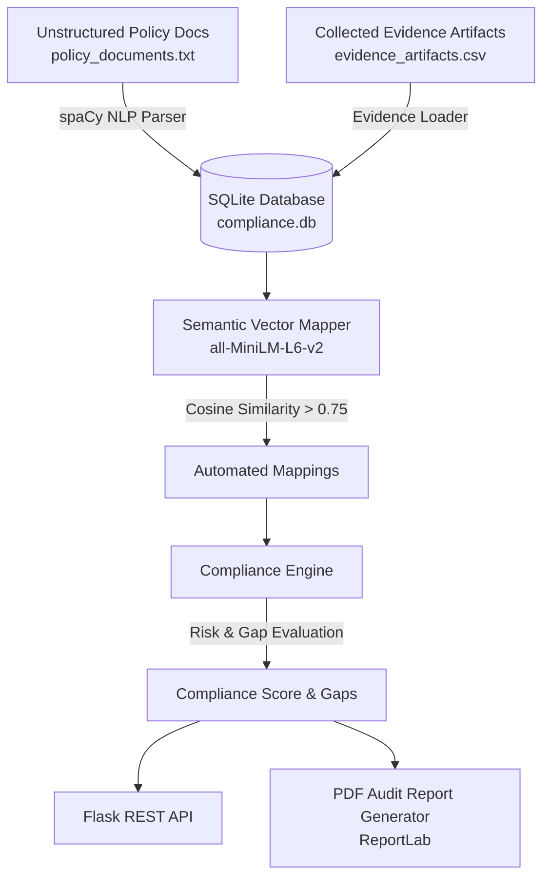

# 🛡️ Automated Compliance Audit & Evidence Collection System

> **AI-Powered Regulatory Compliance Engine, Evidence Verification & Audit Readiness Platform**

[](https://www.python.org/)
[](https://flask.palletsprojects.com/)
[](https://spacy.io/)
[](https://github.com/)
[](LICENSE)

---

## 📌 Overview

Maintaining regulatory compliance across **ISO/IEC 27001, NIST SP 800-53, GDPR, PCI-DSS, and SOX** in modern enterprises typically involves grueling, manual evidence collection across fragmented cloud and on-prem systems.

The **Compliance Audit System** automates this entire audit lifecycle:
1. **NLP Policy Parsing:** Ingests raw security policies and extracts machine-readable, testable compliance requirements using **spaCy**.
2. **Semantic Evidence Mapping:** Uses **Sentence-Transformers (`all-MiniLM-L6-v2`)** to automatically match evidence artifacts (logs, KMS configs, IAM reports) to requirements via cosine similarity.
3. **Automated Risk & Gap Analysis:** Scans for missing evidence, low-confidence artifacts, or verified non-compliance and tags risks accordingly (`CRITICAL`, `HIGH`, `LOW`).
4. **Scoring & PDF Generation:** Calculates continuous compliance readiness scores (0–100%) and generates executive audit scorecards in PDF format via **ReportLab**.
5. **RESTful API:** Exposes endpoints to feed audit dashboards and enterprise governance tools.

---

## 🏗️ Architecture & Data Flow



---

## 📂 Project Structure

```
compliance-audit-system/
├── backend/
│   ├── app.py                     # Flask REST API endpoints
│   ├── compliance_engine.py       # Core compliance calculation & risk evaluation
│   ├── database.py                # SQLite database initialization & connection manager
│   ├── evidence_loader.py         # CSV evidence ingestion engine
│   ├── mapper.py                  # SentenceTransformer semantic similarity matcher
│   ├── policy_parser.py           # NLP policy extraction using spaCy
│   ├── report_generator.py        # PDF audit report generation using ReportLab
│   └── requirements.txt           # Python backend dependencies
├── sample_data/
│   ├── policy_documents.txt       # Sample enterprise policies (Encryption, Access, Audit)
│   └── evidence_artifacts.csv     # 250+ collected evidence artifacts with confidence scores
├── PROBLEM_STATEMENT_03.md        # Detailed domain specification & problem statement
├── .gitignore                     # Git exclusions (venv, caches, etc.)
└── README.md                      # System documentation
```

---

## 📜 Regulatory Standards Covered

- **NIST SP 800-53:** AC-2 (Account Management), AC-3 (Access Enforcement), AU-2 (Audit Events), AU-5, SC-7 (Boundary Protection)
- **ISO/IEC 27001:** A.6 (Organization of Information Security), A.10 (Cryptography), A.12 (Operations Security), A.13 (Communications Security)
- **GDPR:** Article 25 (Data Protection by Design), Article 32 (Security of Processing), Article 33 (Breach Notification)
- **PCI-DSS:** Requirements 1 through 12 (Cardholder data encryption, MFA, access restrictions)
- **SOX Section 302:** Internal access and change auditing controls

---

## 🚀 Getting Started

### 1. Prerequisites
- Python 3.10+ (tested on Python 3.11 & 3.13)
- `pip`

### 2. Environment Setup
```bash
cd compliance-audit-system/backend

# Create and activate virtual environment
python -m venv venv
# Windows:
venv\Scripts\activate
# Linux/macOS:
source venv/bin/activate

# Install dependencies
pip install -r requirements.txt

# Download spaCy English language model
python -m spacy download en_core_web_sm
```

### 3. Pipeline Ingestion & Initialization
Run the ingestion pipeline to parse policies, load evidence, and compute semantic mappings:

```bash
# Ingest policies and evidence into SQLite
python -c "from policy_parser import parse_policy; parse_policy('../sample_data/policy_documents.txt')"
python -c "from evidence_loader import load_evidence; load_evidence('../sample_data/evidence_artifacts.csv')"

# Perform semantic vector mapping
python -c "from mapper import map_evidence; map_evidence()"
```

### 4. Start the Flask API
```bash
python app.py
```
The server will start on `http://127.0.0.1:5000`.

---

## 📡 API Reference

### 1. Health & Root Probe
- **`GET /`**
- **Response:**
  ```json
  { "message": "Compliance Audit System API" }
  ```

### 2. Get Real-Time Compliance Score
- **`GET /score`**
- Evaluates mapped evidence against policy requirements.
- **Sample Response:**
  ```json
  {
    "score": 88.89,
    "results": [
      { "requirement_id": "POL-ENC-001-REQ-1", "status": "COMPLIANT", "risk": "LOW" },
      { "requirement_id": "POL-AC-001-REQ-2", "status": "NON_COMPLIANT", "risk": "CRITICAL" },
      { "requirement_id": "POL-AUD-001-REQ-3", "status": "GAP", "risk": "CRITICAL" }
    ]
  }
  ```

### 3. View Extracted Requirements
- **`GET /requirements`**
- Returns all parsed requirements across policy documents.

### 4. View Evidence Artifacts
- **`GET /evidence`**
- Lists all collected audit artifacts with confidence scores and verification statuses.

---

## 📊 Generating PDF Audit Reports

To generate an executive compliance scorecard PDF:

```bash
python -c "from report_generator import generate_pdf; generate_pdf()"
```
This generates `Compliance_Report.pdf` with overall compliance percentage, breakdown by requirement, and risk severity flags.

---

## 📄 License

Distributed under the [MIT License](LICENSE).
